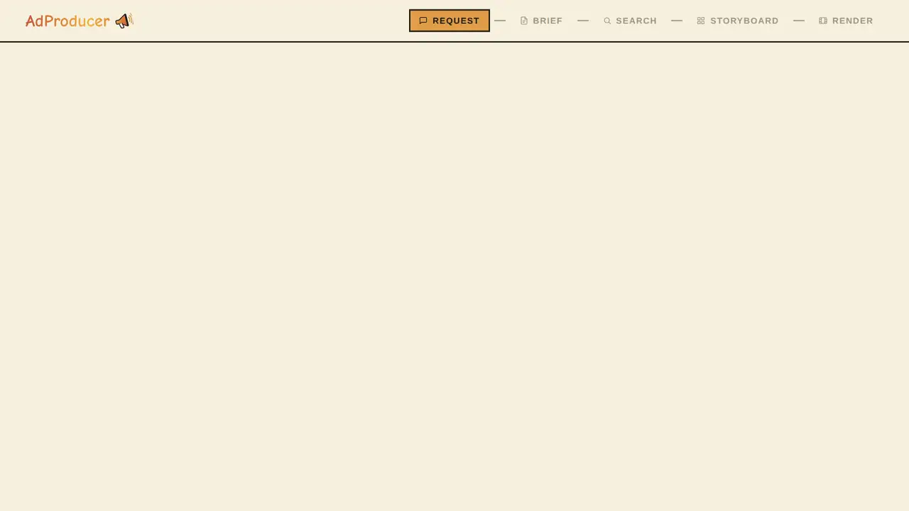
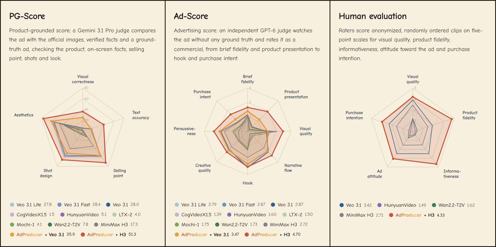

# AdProducer: Towards Agentic Advertising Video Generation

[**🌐 Project Page**](https://lky-ang.github.io/AdProducer-page/) | [**🤗 Models & Data**](https://huggingface.co/AdProducer) | [**📖 Paper**](https://arxiv.org/abs/2611.31466)

# 🎥 Demo: Automated Ad Video Generation

From a seller's product link to a delivered ad:

<div align="center">
  
</div>

<sub>1080p version with music: [assets/demo.mp4](assets/demo.mp4). More ads on the [project page](https://lky-ang.github.io/AdProducer-page/).</sub>

## 👀 Intro

A compelling ad starts with understanding what makes a product worth showing. **AdProducer** turns a short creative brief into a **product-grounded visual story**: it discovers and verifies real product information, retrieves official visual references, and crafts a shot-by-shot storyboard that brings the product's defining features into focus. A frozen video generator (MiniMax H3) then brings that storyboard to life.

Compared with sending the brief directly to the video generator, AdProducer improves **product accuracy**, **information accuracy**, **selling-point expression**, **shot design** and **visual quality**, and its storyboards transfer to other video generators without retraining.

## 🔥 News

- Our paper is available on [arXiv](https://arxiv.org/abs/2611.31466).
- We release the code, the models ([AdProducer-RL-9B](https://huggingface.co/AdProducer/AdProducer-RL-9B), [AdProducer-SFT-9B](https://huggingface.co/AdProducer/AdProducer-SFT-9B)), the [training data](https://huggingface.co/datasets/AdProducer/AdProducer-Train-Data) and [AdCreation-Bench](https://huggingface.co/datasets/AdProducer/AdCreation-Bench).

## 🔍 AdCreation-Bench

<div align="center">
  
</div>

AdCreation-Bench contains 305 advertising briefs across eight domains, spanning products from the 19th century to those released just weeks ago. It evaluates ads from two complementary perspectives: **PG-Score** (product fidelity) and **AD-Score** (ad effectiveness).

## 📁 Repository

```
AdProducer/
├── inference/      product link -> brief -> search agent -> MiniMax H3 ad   (python -m adproducer)
├── training/
│   ├── sft/        supervised cold start with ms-swift                       (train_sft.sh)
│   └── rl/         agentic GRPO with slime, video + text rewards            (train_rl.sh)
├── benchmark/      AdCreation-Bench evaluation: PG-Score and AD-Score
└── assets/
```

## 🛠️ Environment Setup

Each part runs in its own environment. All parts need `ffmpeg` on `PATH`.

#### Inference and evaluation

```bash
conda create -n adproducer python=3.12 -y && conda activate adproducer
pip install -r inference/requirements.txt -r benchmark/requirements.txt
pip install "sglang[all]==0.5.23"                  # serves the policy (tested version)
cp inference/.env.example inference/.env          # search / page-reading keys, brief writer, endpoints
```

MiniMax H3 (the video generator) is served with its own sglang build: follow the MiniMax-H3 repository for the
weights and installation, then start it with `inference/scripts/serve_h3.sh`.

#### SFT

```bash
conda create -n adproducer-sft python=3.12 -y && conda activate adproducer-sft
pip install ms-swift==4.5.3 deepspeed flash-attn
```

#### RL

RL runs inside the [slime](https://github.com/THUDM/slime) docker image. `setup.sh` checks out slime at the pinned
commit and installs the remaining dependencies:

```bash
docker run --gpus all -it -v $PWD:/root/AdProducer slimerl/slime:latest bash
export ADP_DIR=/root/AdProducer/training/rl SLIME_DIR=/root/slime
bash $ADP_DIR/setup.sh
cp $ADP_DIR/.env.example $ADP_DIR/.env            # search / page-reading keys, MiniMax H3 servers, judge
```

RL also needs running MiniMax H3 servers (rendering) and a Gemini 3.1 Pro endpoint (judge); see
[training/rl/README.md](training/rl/README.md).

## 🚀 Training

AdProducer is trained from Qwen3.5-9B in two stages, following Gen-Searcher: SFT on agentic trajectories, then agentic RL.

#### SFT

```bash
# data
hf download AdProducer/AdProducer-Train-Data --repo-type dataset --include "sft_data.json" --include "cached_image/*" --local-dir data
(cd data && for f in cached_image/cached_image_part*.zip; do unzip -q $f -d cached_image/; done)
# launch
DATA_DIR=data bash training/sft/train_sft.sh      # -> output/AdProducer-SFT-9B
```

#### RL

Download the data and the SFT checkpoint and convert the checkpoint to Megatron format as described in
[training/rl/README.md](training/rl/README.md), then launch (inside the slime container):

```bash
set -a; source $ADP_DIR/.env; set +a
bash $ADP_DIR/train_rl.sh
```

## 🔮 Inference

Turn a product link into an ad ([inference/README.md](inference/README.md)):

```bash
cd inference && set -a && . ./.env && set +a
scripts/serve_policy.sh AdProducer/AdProducer-RL-9B 0     # policy (sglang, one GPU, :8000)
scripts/serve_h3.sh /path/to/MiniMax-H3                   # MiniMax H3 reference-to-video (two GPUs, :30011)
python -m adproducer run "https://www.amazon.com/dp/B0DP64X2LT" --out out/heater
```

The run writes the product page facts, the brief, the agent trajectory, the storyboard prompt with its reference images,
and the ad (`out/heater/ad.mp4`). A complete example is in [inference/examples/amazon_heater](inference/examples/amazon_heater).

## 📐 AdCreation-Bench Evaluation

```bash
# data
hf download AdProducer/AdCreation-Bench --repo-type dataset --local-dir data/AdCreation-Bench
(cd data/AdCreation-Bench && unzip -q official_images.zip && unzip -q GT-Video/gt_video.zip)
# run (policy and MiniMax H3 servers as in Inference; keys in inference/.env)
B=data/AdCreation-Bench
python benchmark/bench_eval.py infer    --bench-dir $B --out-dir runs/adproducer --base-url http://127.0.0.1:8000/v1 --model adproducer
python benchmark/bench_eval.py generate --bench-dir $B --out-dir runs/adproducer
python benchmark/bench_eval.py score    --bench-dir $B --out-dir runs/adproducer      # PG-Score
python benchmark/bench_eval.py summary  --bench-dir $B --out-dir runs/adproducer
python benchmark/ad_score.py --bench-dir $B --videos runs/adproducer/videos --out runs/adproducer/ad_score.jsonl   # AD-Score
```

To evaluate another system, put its videos in `runs/<method>/videos/<id>.mp4` and run `score` and `ad_score.py`. Details: [benchmark/README.md](benchmark/README.md).

## 🏆 Results on AdCreation-Bench

<div align="center">
  
</div>

<sub>PG-Score dimensions in percent; AD-Score dimensions on 1-5 (overall on 1-10); human ratings are mean opinion scores on 1-5. Interactive version on the [project page](https://lky-ang.github.io/AdProducer-page/#eval).</sub>

## Acknowledgements

We sincerely thank the open-source community. Related projects include [Gen-Searcher](https://github.com/tulerfeng/Gen-Searcher), [slime](https://github.com/THUDM/slime), [ms-swift](https://github.com/modelscope/ms-swift) and [MiniMax H3](https://github.com/MiniMax-AI/MiniMax-H3).

## Citation

```bibtex
@article{li2026adproducer,
  title   = {AdProducer: Towards Agentic Advertising Video Generation},
  author  = {Li, Kunyang and Wang, Chaoyang and Shah, Mubarak and Shang, Yuzhang},
  journal = {arXiv preprint arXiv:2611.31466},
  year    = {2026}
}
```

## License

The code is released under Apache-2.0, and the datasets on Hugging Face under CC BY-NC 4.0. Product names, page text and product images in `inference/examples/` and in the demo belong to their owners and are shown only to illustrate the pipeline. The ads in this repository are AI-generated with MiniMax H3; MiniMax H3 and its outputs are subject to the [MiniMax H3 Community License](https://huggingface.co/MiniMaxAI/MiniMax-H3/blob/main/LICENSE).
